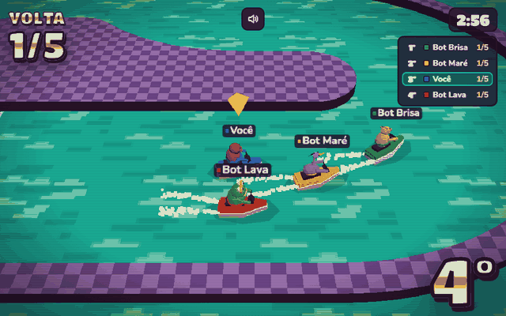
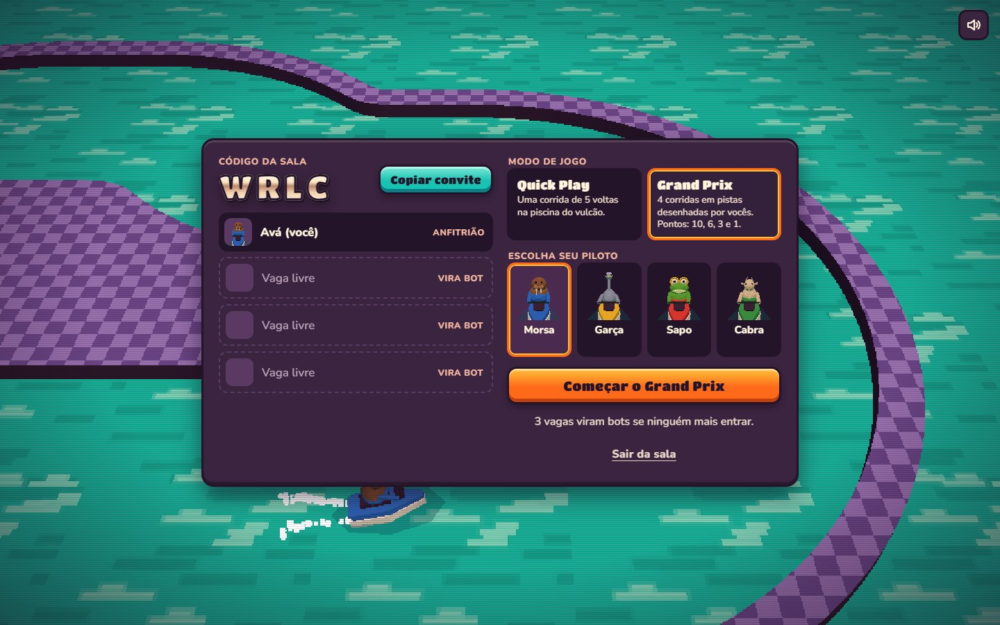
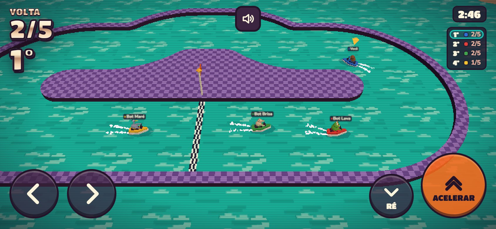
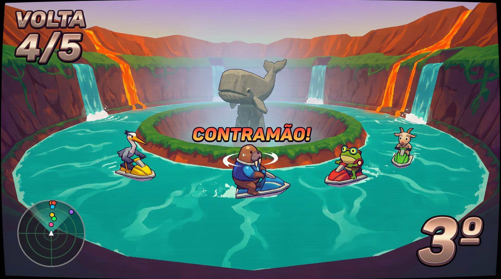
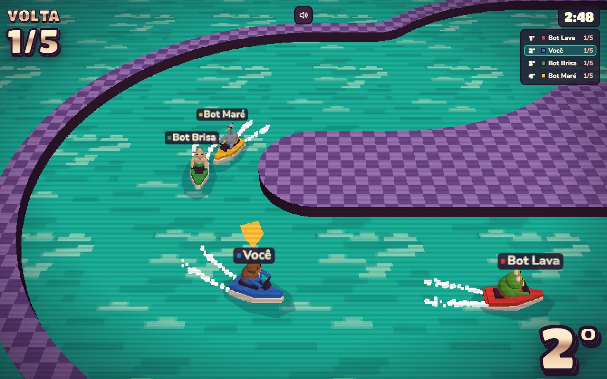
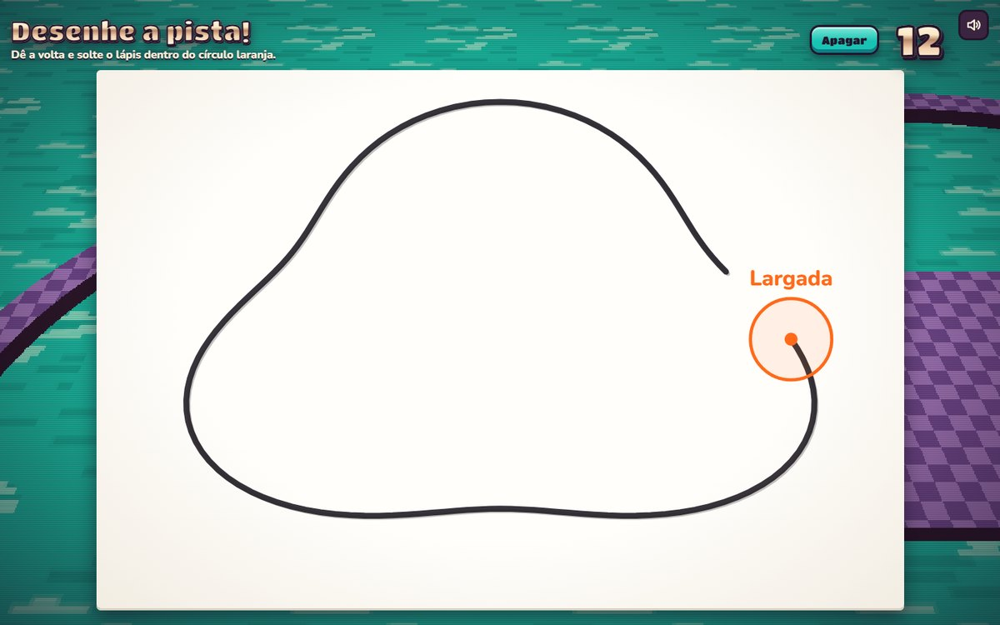
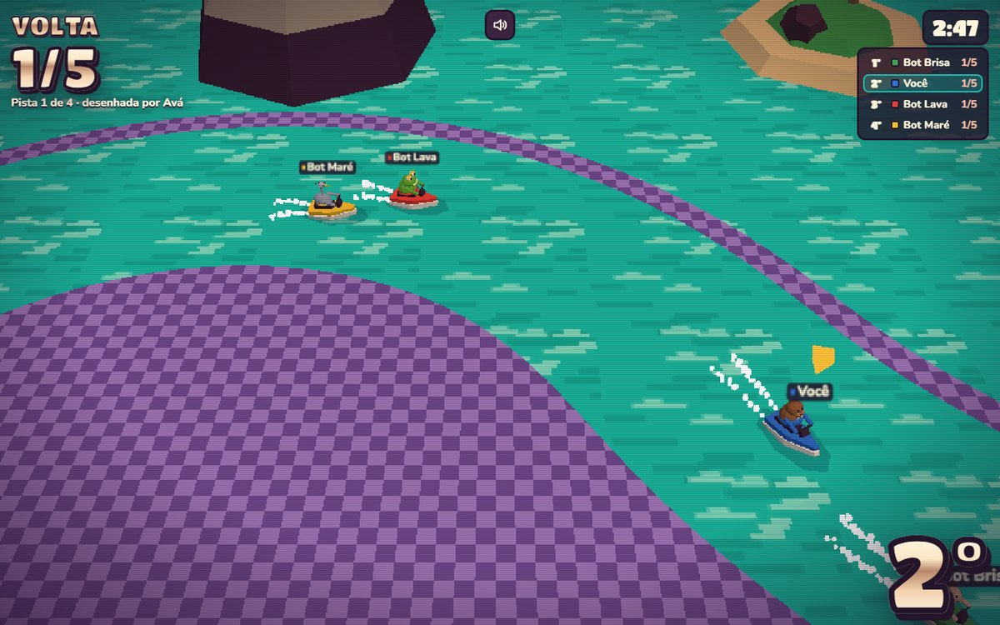

# Bicho d'Água

An online jet-ski race for up to 4 friends, played in the browser. Four animal racers, a pool inside a volcano, 5 laps, and the look of a late-90s console game on a CRT TV. No install, no account: open the link, share a 4-letter code, race. **[bicho-dagua.onrender.com](https://bicho-dagua.onrender.com)**



<p>
  
  
</p>

> The game's interface is in Brazilian Portuguese. The server runs on Render's free plan, so the first visit after a quiet spell takes about a minute to wake it up.

## Why I built it

Party games always had that one minigame everyone asked for again: a short water race, first to finish 5 laps. I wanted that feeling for friends on a video call, each on their own device, some on a laptop and some on a phone. So the rule from day one was *from link to racing in under a minute*.

## Design and product decisions

**Six worlds before one line of game code.** I generated six key visuals in different materials (paper boats in a storm, water-park floats, woodcut rafts, clay capybaras, an Art Deco regatta, a late-90s console) and judged each one on whether Three.js could run it smoothly on a phone. The low-poly console won: it's nostalgic, and it's cheap to render.

<p>
  
  
</p>

<sub>Left: the key visual. Right: the game. The other five directions are in [docs/keyvisuals](docs/keyvisuals/README.md).</sub>

- **Low resolution as a style and as a budget.** The 3D scene renders at 560 lines and is scaled up with nearest-neighbor filtering, with CSS scanlines and a vignette on top. That is the visual signature, and it's also what keeps phones at a steady frame rate.
- **The camera is the difficulty.** A fixed overhead angle frames only the racers still in the race: it zooms in when they bunch up and opens to the whole pool when they spread out. Any collision stops your jet-ski, so you have to brake before the turns, and steering is relative to the boat, so it flips when you head toward the screen.
- **Nobody waits for a full room.** Bots fill the empty slots, so two friends (or one) can start right away. Bots race in the standings and score points like anyone else.
- **A chrome HUD from a cartridge.** Lap count, position and the countdown use a cream-to-copper gradient with a hard bevel, taken straight from the key visual. Buttons feel like plastic controller keys. The palette, type and components are documented in [DESIGN.md](DESIGN.md).
- **Phones are first-class.** Touch controls on screen, a HUD that steps aside so the boats stay visible, and a full-screen *Deite o celular* (turn your phone sideways) notice in the lobby and in races.
- **Everything is original.** Characters, art, sounds and names, so there is never a reason to take it down.

### Grand Prix: race on tracks you draw

<p>
  
  
</p>

Four races, each on a track drawn by one of the players. Before each race a roulette picks who draws, and that player has 15 seconds to sketch a closed loop. The drawing becomes a racing track through geometry only ([`shared/sketch.js`](shared/sketch.js)), with no paid API. The cleanup makes any scribble raceable: it smooths the hand's wobble, removes loops too small to drive, rounds off corners that are too tight, pushes apart stretches that touch, and widens the angle where the line crosses itself, so a figure-8 becomes a bridge over a tunnel. Points go 10, 6, 3 and 1, and the champion lifts a trophy on the podium. The full rules are in [docs/grand-prix.md](docs/grand-prix.md).

**Stack:** Three.js, Node.js, Express, Socket.IO, Vite, `node:test`, Render. Key visuals generated in Krea.

**Built with AI.** I write the code with Claude Code as a pair. The design and product decisions are mine.

---

## Playing

1. One player clicks **Criar sala** and gets a 4-letter code.
2. The others enter the code, or open the link from **Copiar convite**.
3. Each player picks a racer: Morsa, Garça, Sapo or Cabra.
4. The host picks the mode, **Quick Play** (one race) or **Grand Prix** (4 races on tracks you draw), and starts.

| | Steer | Accelerate | Brake / reverse |
|---|---|---|---|
| Keyboard | **A** / **D** (or ← →) | **J** (or ↑) | **K** (or ↓) |
| Phone | on-screen ‹ › buttons | **Acelerar** button | **Ré** button |
| Gamepad | left stick or d-pad | A or RT | B or LT |

The first to finish 5 laps wins. If nobody finishes within 3 minutes, the race is a draw. A race lasts about 1 minute.

The Quick Play track is a pool seen from above, with a wall down the middle: a starting straight, two tight 180° turns at the ends, and a chicane on the top straight. The jet-ski takes about 5 seconds to reach top speed, and **any collision stops it**, whether with the wall or another jet-ski. If you turn around, **CONTRAMÃO!** appears on screen. After you cross the finish line, the camera moves behind your jet-ski, which keeps lapping on its own while the others finish.

### Grand Prix rules

Before each race the game picks a human player (everyone draws once before anyone repeats). The loop closes when the pencil is lifted inside the orange start circle, and that point becomes the start. If the drawing does not become a track, the player gets 10 more seconds; if it fails again, the race uses the Quick Play pool. The others wait without seeing the drawing. A figure-8 can cross itself up to 3 times. Bots score too. Ties are broken by wins, then by the last race.

## Running locally

```bash
npm install
npm run dev     # game server on 3000 and Vite on http://localhost:5173
npm test        # simulation and room tests
```

To test the production build: `npm run build && npm start`, then open http://localhost:3000.

## Publishing on Render (free plan)

The repository includes `render.yaml`. One Node service serves both the game and the multiplayer.

1. On [render.com](https://render.com), click **New → Blueprint** and choose this repository.
2. Render reads `render.yaml`. Confirm the **Free** plan and create the service.
3. When the deploy finishes, share the `https://bicho-dagua.onrender.com` link (or whatever name Render assigns).

On the free plan the server sleeps after 15 minutes without players. The first visit after that takes about 1 minute to wake it up.

## Structure

- `shared/`: rules, track, physics and bots. The same code runs on the server and in the browser.
- `server/`: Express + Socket.IO. Handles rooms, countdown, laps, standings and the bots.
- `client/`: Three.js scene, characters, HUD, menus and touch controls.
- `docs/keyvisuals/`: the 6 visual directions explored (we chose number 3).
- `PRODUCT.md` / `DESIGN.md`: the product brief and the visual system.

## Networking

Each browser simulates its own jet-ski and sends its position 20 times per second. The server checks that the movement is plausible, computes laps and standings, drives the bots, and sends a snapshot of everyone back 20 times per second. The other jet-skis are drawn 120 ms in the past, which makes their movement smooth. When a network blocks WebSocket, the connection falls back to HTTP polling.

## Test mode

Adding `?autopilot=1` to the address makes your jet-ski drive itself. It is used by automated tests (and it recorded the GIF above).

With the server started with `BICHO_DEV=1`, two shortcuts help test drawn tracks by hand: `node scripts/dev-sketch.js CODE figureEight 3` sends a test drawing for the next start in room `CODE`, and the `dev:finish` socket event ends the current race at once. `node scripts/sketch-gallery.js` renders how the test drawings become tracks (`dist/sketch-gallery.html`).
